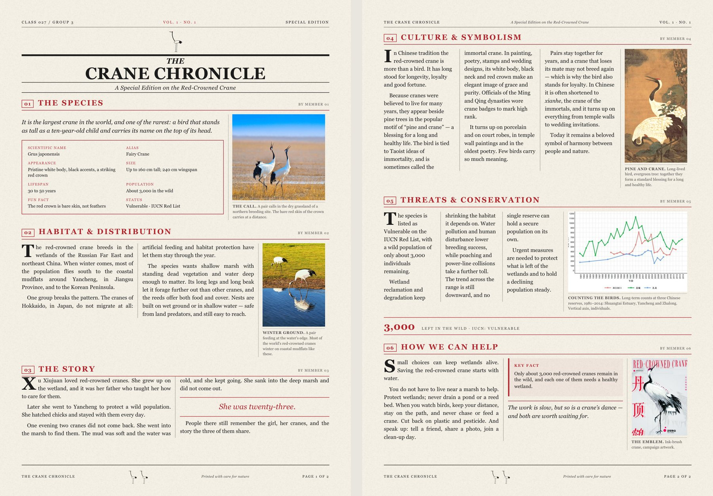

# newspaper-studio

把一份 JSON 排版成**仿新闻纸的报纸 / 特刊 / 课堂小报**：HTML + PDF + 逐版 PNG。

不用 InDesign，不用 Illustrator。写内容，给图片，跑一条命令。



---

## 它解决什么问题

手工排报纸最费时间的两件事：**图放多大**、**这版到底塞不塞得下**。
这个工具把这两件事变成一次自动收敛：

- 反复打印真实 PDF，用 pymupdf 量出每页正文的实际下沿（毫米）；
- 装不下就把图片等比收小（二分逼近），还不行就降 0.3pt 字号再试；
- 装完还有空就反向放大图片，把版面填满；
- 图片**只缩放、不裁剪**——`height:auto`，永远保持原始比例。

你给一个大概的图片宽度，剩下的它自己解决。

---

## 安装

```bash
git clone https://github.com/<you>/newspaper-studio.git
cp -r newspaper-studio ~/.dsh/skills/          # 作为 DSH / Claude Skill 使用
```

依赖只有三样（本机通常已有）：

```bash
python -c "import fitz, PIL"   # pymupdf、Pillow
# 以及 Chrome 或 Edge（用于无头打印 PDF，脚本会自动找路径）
```

---

## 快速开始

```bash
cd newspaper-studio
python scripts/newspaper.py examples/crane/spec.json
```

输出在 `examples/crane/`：

```
the-crane-chronicle.html        屏幕版，多版并排
the-crane-chronicle.pdf         印刷版，一版一页
the-crane-chronicle-p1.png      逐版位图
the-crane-chronicle-spread.png  跨页预览
```

---

## spec.json 长什么样

```json
{
  "name": "my-paper",
  "paper": { "size": "A4" },
  "pages": 2,
  "style": { "paper": "#f6f1e7", "ink": "#1c1c1c", "accent": "#b3272d", "body_pt": 9.2 },
  "masthead": {
    "mark": true,
    "kicker": { "left": "Class 027", "mid": "Vol. 1 · No. 1", "right": "Special Edition" },
    "pre_title": "The",
    "title": "Crane Chronicle",
    "subtitle": "A Special Edition on the Red-Crowned Crane"
  },
  "footer": { "left": "The Crane Chronicle", "mid": "Printed with care for nature",
              "page": "Page {n} of {total}", "marks": 2 },
  "sections": [
    {
      "page": 1, "num": "01", "title": "The Species", "byline": "By Member 01",
      "lede": "It is the largest crane in the world…",
      "facts": [["Scientific name", "Grus japonensis"], ["Status", "Vulnerable · IUCN"]],
      "figure": { "src": "img/fig1.jpg", "width_mm": 58, "caption": "<b>THE CALL.</b> A pair calls…" }
    },
    {
      "page": 1, "num": "02", "title": "Habitat", "byline": "By Member 02",
      "body": ["Para one…", "Para two…", { "pullquote": "She was twenty-three." }, "Para three…"],
      "figure": { "src": "img/fig2.jpg", "width_mm": 40, "caption": "…" }
    }
  ]
}
```

完整字段表见 [`SKILL.md`](SKILL.md)，可打印速查见 [`reference/spec.md`](reference/spec.md)。

---

## 能调什么

| 维度 | 选项 |
|---|---|
| 纸张 | A3 / A4 / A5 / Letter / Tabloid / 自定义 mm，可横版 |
| 页数 | 任意；每节可用 `page` 指定排第几版 |
| 字体 | 任意 CSS 字体栈（`serif` / `sans`），字号行距可调 |
| 配色 | 纸色 / 墨色 / 点缀色三个变量 |
| 栏数 | 全局默认 + 单节覆盖（3 栏自动左对齐） |
| 节内容 | 导语、正文、小标题、拉引、资料框、数据条、关键事实、收尾句 |
| 图片 | 每节一张，宽度可调，**永不裁剪** |

---

## 已经踩过的坑（都在 `SKILL.md` 里）

1. 图片别用 `object-fit:cover` —— 会裁图。
2. 三栏必须左对齐 —— Chrome 在 Windows 上不做断词，两端对齐会拉出"河流"。
3. 页脚是绝对定位，量测时要跳过，否则每页都"永远装不下"。
4. 打印副本必须放在输出目录 —— 否则 `img/` 相对路径全断，页面上只剩图注。
5. 中文字体名要用 PIL 读出来的 family 名，别靠猜。

---

## 结构

```
newspaper-studio/
├─ SKILL.md                 使用说明（给 agent 看的）
├─ scripts/newspaper.py     渲染 + 打印 + 量测 + 自动试排
├─ resources/
│  ├─ base.css              全部版式规则
│  └─ grain.png             纸张纤维纹理
├─ reference/spec.md        字段速查
└─ examples/crane/          两版六节五图的完整例子
```

## License

MIT
